<h1><picture></picture> hi, i'm eve 👋</h1>

software engineering student who writes mostly typescript 
and makes her arch setup cozy instead of doing homework

<picture></picture> 

she/her. i make discord bots, little tools and dotfiles, and rice my arch setup more than i actually use it. i'm told i look serious, i'm just thinking about how to break into something (ethically, obviously), so it's ctfs, flipper zero apps, and games when i should be asleep, all on too much monster

 

<picture></picture>

### stuff i make
- discord bots in typescript (discord.js + sapphire, sqlite)
- dotfiles and shell stuff for hyprland + fish
- small themes and tweaks for the apps i use
- flipper zero apps, when i should be doing other things

<picture></picture> 

### what i actually use
arch linux, hyprland with my own fork of dank material shell, neovim, fish + starship. typescript + node is the daily driver, with biome and yarn. i can also get around in c, c++, python, lua, bash, java, kotlin, go, c#, and qml

 

<picture></picture>

<picture></picture> 
thanks for stopping by <picture></picture>

