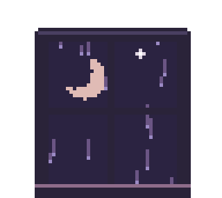
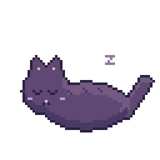

<h1>hi, i'm eve 👋</h1>

software engineering student who writes mostly typescript 
and makes her arch setup cozy instead of doing homework

 

 she/her. i make discord bots, little tools and themes, dotfiles, and apps for my flipper zero (the one i keep flashing). if it has a config file i've probably lost a weekend to it, and i rice my arch setup more than i actually use it

i do ctfs and poke at things i probably shouldn't. i'm told i look serious, i'm just thinking about how to break into something (ethically, obviously). i game when i should be asleep, and i run on not enough sleep and too much monster

 

### stuff i make
- discord bots in typescript (discord.js + sapphire, sqlite)
- dotfiles and shell stuff for hyprland + fish
- small themes and tweaks for the apps i use
- flipper zero apps, when i should be doing other things

 

### what i actually use
arch linux, hyprland, neovim, fish. typescript + node is the daily driver 
i can also get around in c, c++, python, lua, bash, java, go, c#, and qml

 

 

thanks for stopping by <picture></picture>

